<div align="center">

<a href="https://aun.sh"></a>

# aun.sh

**A portfolio that's a place, not a list.**

The projects stand on a 3D landscape, the jobs run across it as a trail,<br>
and the loading screen is a survey of the same land, drawn from above.

[**Visit aun.sh**](https://aun.sh) · [The case study](https://aun.sh/work/portfolio) · [Résumé](https://aun.sh/resume.pdf)


</div>

<br>

<a href="https://aun.sh">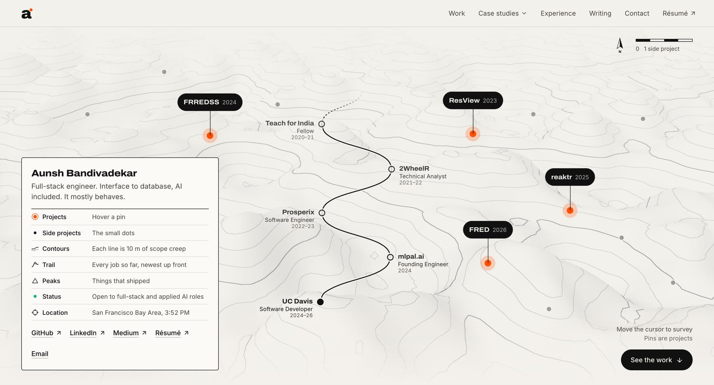</a>

<br>

## The tour

<table>
  <tr>
    <td width="50%">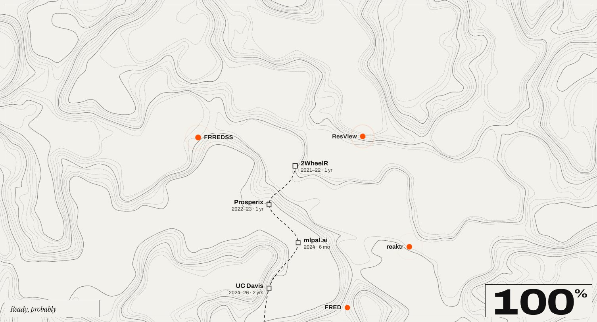</td>
    <td width="50%">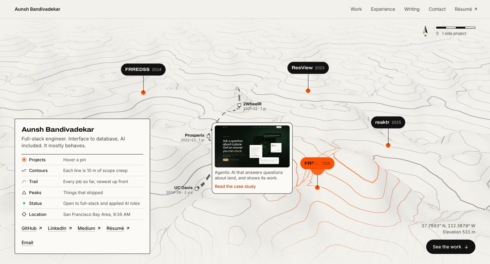</td>
  </tr>
  <tr>
    <td><b>A survey first.</b> On the first visit of a session, contour lines draw in from the valleys up, the trail walks through each job, the projects get plotted, and the sheet tips back into the 3D land.</td>
    <td><b>Then the land.</b> Projects are pins, side projects are small dots, and jobs are stops on a switchback trail. Move the pointer and a hill rises under it. Hover a pin and the cursor says <i>Go</i>.</td>
  </tr>
  <tr>
    <td>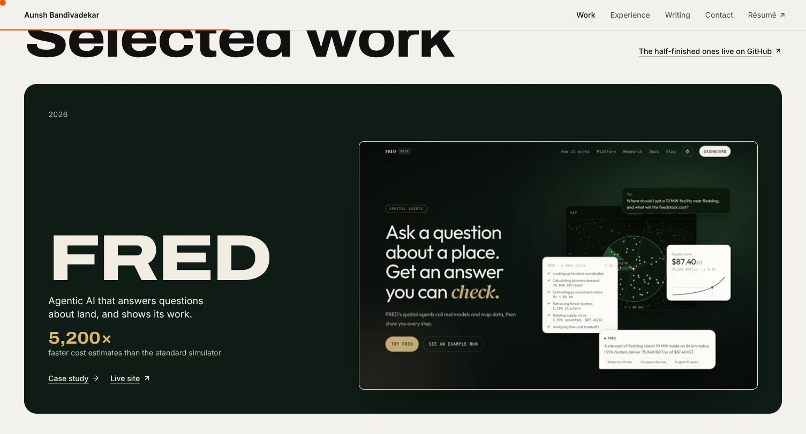</td>
    <td>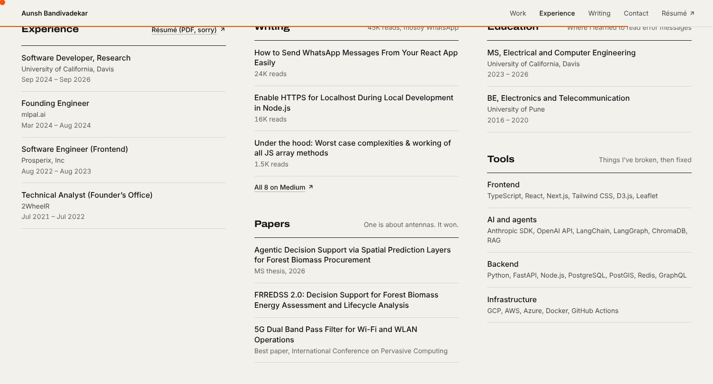</td>
  </tr>
  <tr>
    <td><b>Selected work.</b> Each card wears the product's own colors and stacks under the next as you scroll.</td>
    <td><b>The fine print.</b> Everything a recruiter scans for, in three quiet columns.</td>
  </tr>
</table>

<table>
  <tr>
    <td width="25%">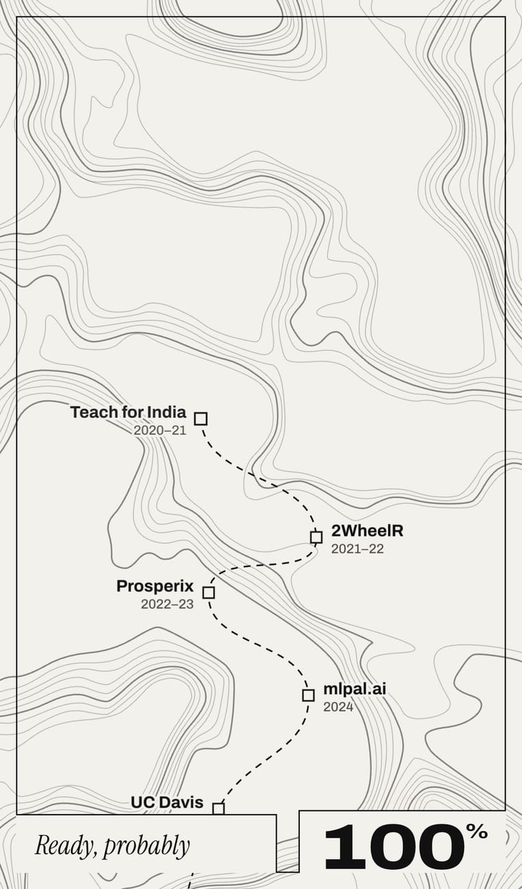</td>
    <td width="25%">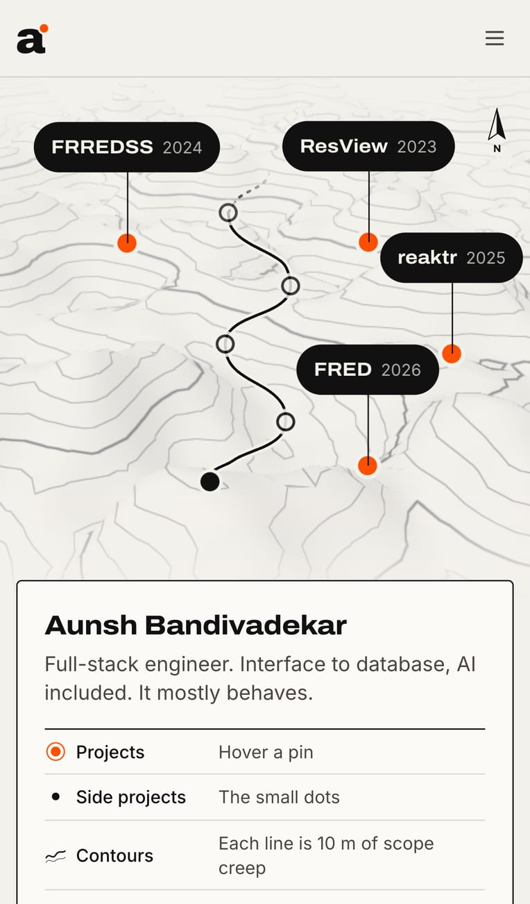</td>
    <td width="25%">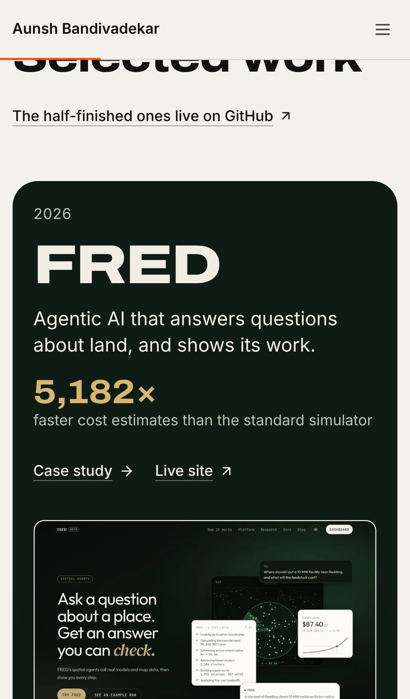</td>
    <td width="25%">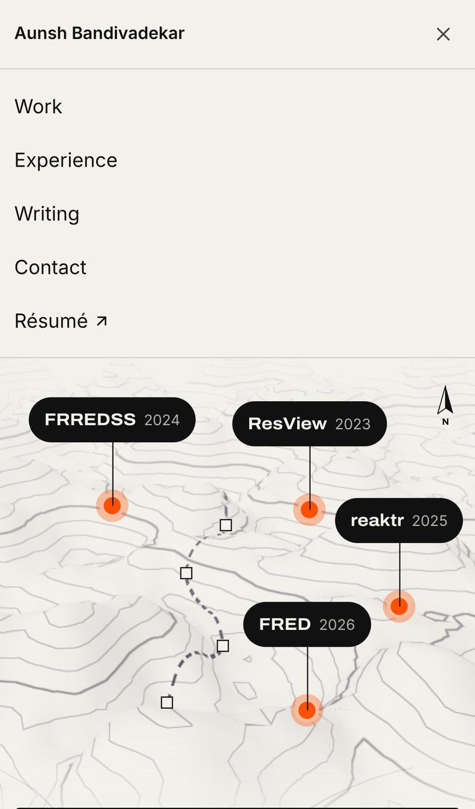</td>
  </tr>
  <tr>
    <td align="center"><sub>Loader</sub></td>
    <td align="center"><sub>Hero</sub></td>
    <td align="center"><sub>Work</sub></td>
    <td align="center"><sub>Menu</sub></td>
  </tr>
</table>

## How it works

### One noise, everywhere

Everything on the land comes from one 2D simplex noise function. The GPU draws the land with it, a CPU copy keeps the HTML pins and the SVG trail on the ground, and a build script turns it into the loader's contour map. So the map you see first is the land you arrive on.

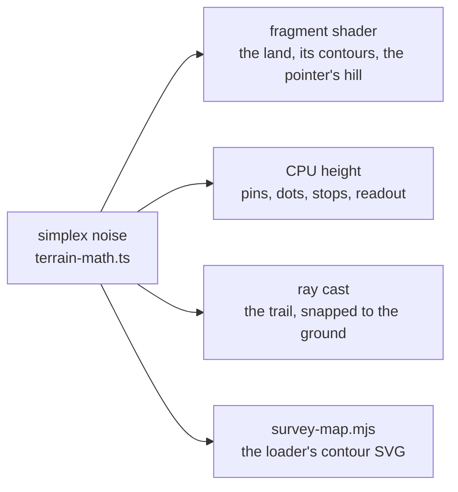

### Contours without geometry

There are no line meshes. Each pixel checks how close its height is to a contour level and inks itself if it's close. `fwidth` keeps the lines the same width at any distance, every fifth line is thicker, the light is worked out per pixel, and the land fades into haze far away.

```glsl
float v = vH * 9.0;
float f = fract(v);
float w = fwidth(v);
bool index = mod(floor(v + 0.5), 5.0) == 0.0;
float line = 1.0 - smoothstep(0.0, w * (index ? 1.7 : 1.0), min(f, 1.0 - f));
```

<sub>From <a href="components/motion/TerrainField.tsx">components/motion/TerrainField.tsx</a>, which is raw WebGL2: no three.js, no 3D library at all.</sub>

### A trail that rides the hills

The career trail used to be drawn in the shader, and it broke wherever a ridge hid it. Now it's laid out once per resize as a screen-space switchback against the camera at rest. Each sample point is ray-cast down onto the terrain, then re-projected every frame as a plain SVG path, so it sways and scrolls with the land and stays whole and sharp.

### A loader that runs before JavaScript

The loading screen is CSS. Its 0–100 counter is a typed custom property that animates, and a CSS counter prints it:

```css
@property --n { syntax: "<integer>"; initial-value: 0; inherits: false; }
.preloader-n { counter-reset: n var(--n); animation: pre-count 1.75s forwards; }
.preloader-n::after { content: counter(n); }
@keyframes pre-count { to { --n: 100; } }
```

GSAP and Lenis load after hydration, so they never hold up the first paint. Reduced motion skips all of it, and the header just shows the logo.

## Numbers

A cold load of the home page, loader included, served by `next start` and read from the browser's Performance API.

| Measure | Result |
| --- | --- |
| First-load JavaScript, home page | **120 KB** |
| JavaScript in total, motion libraries included | 182 KB in 13 files |
| CSS | 14 KB |
| Fonts | 170 KB in four files |
| The loader's animated map | 26 KB |
| Requests | 28 |
| Cumulative layout shift | **0.002** |
| 3D libraries | **0** |

## Design

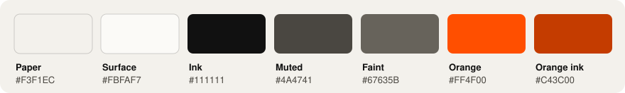

Warm paper, near-black ink, international orange. Orange only marks things that respond to you: pins, the pointer's hill, the *Go* cursor, links on hover, and the dot on the logo. It's light mode only, because the paper is part of the map.

| Typeface | Job |
| --- | --- |
| **Archivo** | Statements and the big words. Its weight and width bend toward the pointer in the footer. |
| *Instrument Serif* | Asides and jokes, always in italic. |
| Inter | Everything you read for longer than a line. |
| JetBrains Mono | Case studies only, so the home page doesn't preload it. |

The logo is Archivo's "a" at weight 900 with an orange pin on its shoulder. In the header, the name shows first, then folds away letter by letter into it. That happens once per session, and hovering brings the name back.

## Stack

| Layer | Tools |
| --- | --- |
| Framework | Next.js 15 (App Router, every page static), React 19, TypeScript |
| Styling | Tailwind CSS 4 plus hand-written CSS in `styles/globals.css` |
| 3D | Raw WebGL2 and GLSL, with HTML and SVG on top |
| Motion | GSAP (ScrollTrigger, SplitText) and Lenis, loaded after hydration |
| Search and sharing | Metadata API, a JSON-LD graph, OG and Twitter cards from `next/og` |
| Hosting | Netlify, with a Next.js middleware for short links and one scheduled function |

## Project layout

```text
app/
  layout.tsx            fonts, metadata, the pre-paint motion bootstrap, site JSON-LD
  page.tsx              home: hero, statement, work, fine print
  work/[slug]/          case study pages, generated from content/case-studies.ts
  tldr/                 a short page of links, for people in a hurry
  opengraph-image.tsx   the share card, drawn as a miniature of the hero
  manifest.ts, robots.ts, sitemap.ts
components/
  motion/               TerrainField (WebGL), terrain-math, Preloader, Motion (GSAP, Lenis, cursor)
  sections/             Hero, Statement, Work, FinePrint
  layout/               Header, Brand (the logo fold), Footer, CaseStudyMenu
  case-study/           the case study template and screenshot frames
content/                every word, link, project and coordinate on the site
lib/seo.ts              structured data for the person, the site and each case study
scripts/survey-map.mjs  regenerates the loader's contour map from the terrain noise
middleware.ts           hostname short links (tldr., demo., visaverify., thesis.)
```

## Run it

You need Node 20, which is what Netlify builds with.

```bash
npm install
```

```bash
npm run dev
```

Then open [localhost:3000](http://localhost:3000). The loader plays once per browser session. Open a new tab to see it again.

| Script | Does |
| --- | --- |
| `npm run dev` | Dev server with hot reload |
| `npm run build` | Production build |
| `npm start` | Serves the production build |
| `npm run lint` | ESLint |
| `npm run typecheck` | `tsc --noEmit` |

## Change what it says

All the content is typed data in `content/`, and the components only read it.

| To change | Edit |
| --- | --- |
| Name, role, pitch, links, footer | `content/profile.ts` |
| A project on the land | `content/work.ts`, plus its spot in `PLACES` in `content/places.ts` |
| A case study | `content/case-studies.ts`, with images in `public/images/case-studies/<slug>/` |
| A job | `content/experience.ts`, plus a slot in `JOBS` in `content/route.ts` (one per job, newest first) |
| A side project dot | `content/side-projects.ts`, plus its spot in `DOT_PLACES` in `content/places.ts` |
| Papers, writing, education, tools | `research.ts`, `writing.ts`, `education.ts` and `skills.ts` in `content/` |
| The résumé | Replace `public/resume.pdf` |

Land coordinates are terrain units: `x` runs to the right and `z` runs away from the camera, so more negative is farther. If you move pins or jobs, regenerate the loader's map so it still matches the land. The command is at the top of `scripts/survey-map.mjs`.

## Deploy

Netlify builds `main` with `@netlify/plugin-nextjs`. Analytics load only in production builds on the production context, so `npm run dev`, deploy previews and branch deploys stay out of the numbers.

| Host | Goes to |
| --- | --- |
| `tldr.aun.sh` | `aun.sh/tldr` |
| `demo.aun.sh` | The VisaVerify demo, keeping its path and query |
| `visaverify.aun.sh` | The VisaVerify site |
| `thesis.aun.sh` | The thesis PDF |

`netlify/functions/keep-alive.mjs` pings the VisaVerify backend every 14 minutes, so its free Render instance doesn't fall asleep before a demo.

<br>

<div align="center">
<sub>Built in CA, mostly after midnight. © 2021–26 · v7.0.3</sub>
</div>
